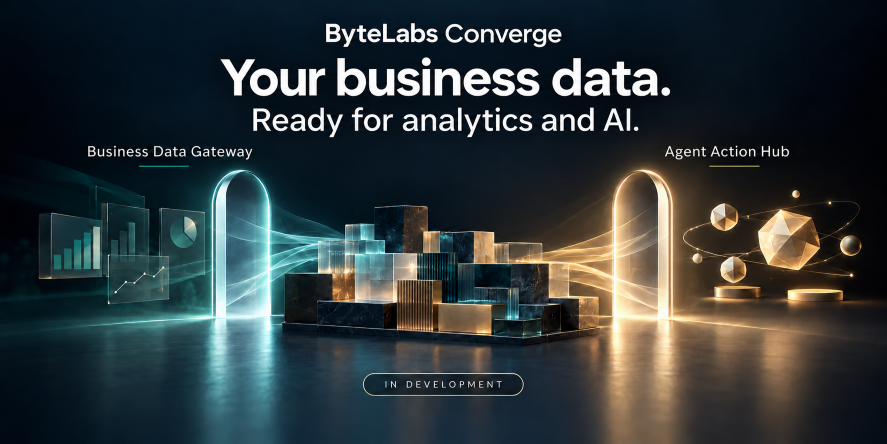
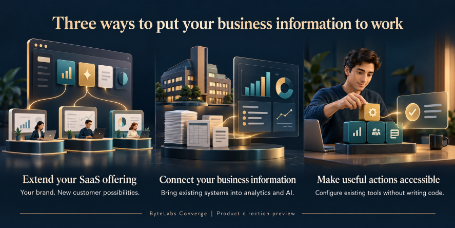

# ByteLabs Converge

**Your business data. Ready for analytics and AI.**

ByteLabs Converge is a product portfolio from **ByteLabs InfoWorks Inc.**, bringing together **Business Data Gateway** and **Agent Action Hub**: two complementary products in development to connect business information and capabilities with analytics and AI.

Business data already lives in operational applications, databases, warehouses, and files. Making that data useful to analytics tools and AI agents should not require a custom integration project for every use case.

We are developing software that helps SaaS providers and enterprises expose approved data and capabilities through governed interfaces, while retaining control over their systems and deployment environment.

## Business Data Gateway

Make existing business data available to the people, applications, and agents that need it, with control over what each customer or user can access.

The platform is being developed to support:

- Enable customer analytics without granting direct database access.
- Give different customers and users access to the information they are permitted to see.
- Reuse existing business data across reporting and AI use cases.
- Reduce repeated custom integration work.
- Retain control over where source systems run.

The existing platform originated from a practical need: helping customers analyze their own information while keeping the underlying business systems private. Work is underway to expand its commercial capabilities and supported integrations.

## Agent Action Hub

Turn useful business functions into capabilities that AI agents can discover and use under your organization's access policies.

The planned experience serves both developers and nontechnical users:

- **Developers:** publish their own capabilities directly, share reusable offerings through a marketplace, or do both.
- **Business users:** adopt and configure existing capabilities without writing the underlying code.
- **Administrators:** govern which tools are available and who can use them.

A working foundation is in place. The broader publishing, management, and marketplace experience is in development.

## Useful independently. Stronger together.

Use Business Data Gateway to enable governed access to business information, Agent Action Hub to make business functions available to agents, or combine them to give agents approved access to relevant data and capabilities.

## Where Converge can help

**Extend your SaaS offering.** Add customer-facing analytics and agent capabilities under your own brand. Our planned OEM licensing model is intended for software providers across industries.

**Connect your business information.** Make approved information from business applications, databases, and spreadsheets useful for reporting and AI. Deployment, configuration, and administrator training are intended to help customers get started without building a dedicated integration team.

**Make useful actions accessible.** Developers publish reusable capabilities; business users configure existing tools for their own needs. Optional services can help create business-specific tools and integrations.

These are illustrative use cases for the product direction, not customer deployments or screenshots of the current interface.

Microsoft Foundry is an intended integration target. Integration availability and supported configurations will be announced as they are validated.

## Deploy where you choose

The initial commercial focus is customer-operated software: deploy in your own cloud environment or on servers in your data center.

The goal is to make existing information useful without requiring customers to relocate their source systems or build a separate data-copying project. Approved information supplied to cloud-hosted analytics or AI services still crosses that service boundary.

Each product is planned to be licensed separately, with a bundled discount. The embedded offering is planned around an annual runtime license. A vendor-operated SaaS offering is a later phase.

## Follow the development

This repository is a preview of the product direction. It is not a source-code release, downloadable product, or commitment to a release date. Public updates will focus on capabilities, demonstrations, and availability as development progresses.

We are interested in hearing from:

- SaaS providers looking to add customer-facing data and AI capabilities.
- Integrators delivering customer-operated solutions.
- Enterprise teams exploring governed access to existing business systems.
- Developers interested in reusable agent tools and integrations.

**Star or watch this repository for updates.** Feedback on use cases and adoption requirements is welcome through GitHub Issues, where enabled. Please keep examples free of confidential information, credentials, and customer data.

---

Product names, packaging, supported integrations, and availability are subject to change. References to third-party products describe intended interoperability and do not imply affiliation or endorsement.
